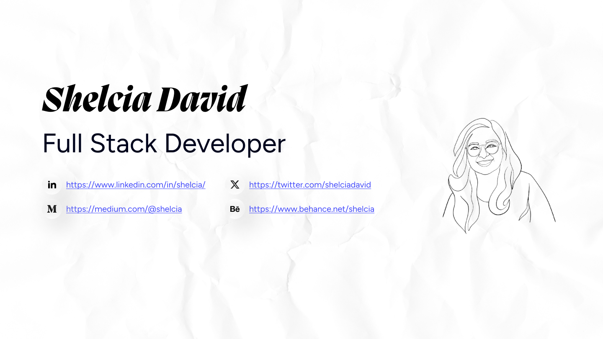

---

# Hi, I’m Shelcia

Frontend-focused engineer building production systems with **React, TypeScript, and Go**.

I care deeply about:
- Scalable frontend architecture
- Performance & accessibility
- Clean design systems
- Observability & reliability
- Shipping polished user experiences

Currently building tracking systems and internal tools at scale.

---

## What I Do

- Design systems from Figma → Production
- Build resilient frontend architectures
- Write type-safe, maintainable TypeScript
- Build backend services in Go & Node
- Work across AWS (S3, infra, CI/CD)
- Think in systems, not components

---

## Tech I Actually Use

### Frontend
React · Next.js · TypeScript · GraphQL · Redux · Tailwind · ShadCN

### Backend
Go · Node.js · Express · REST · GraphQL · MongoDB

### Infra
AWS (S3, CI/CD) · Docker · Terraform · GitHub Actions

---

## GitHub Stats

---

## Writing

- Send Emails from your NodeJs App with Node mailer  
- NodeJs With JWT Authentication  
- Build Your First Discord GIF BOT and Deploy  

(More on Medium → https://medium.com/@shelcia)

---

## 📫 Connect

[LinkedIn](https://www.linkedin.com/in/shelcia/)  
[Twitter](https://twitter.com/shelciadavid)  
[Medium](https://medium.com/@shelcia)

---

_Always building. Always refining._
